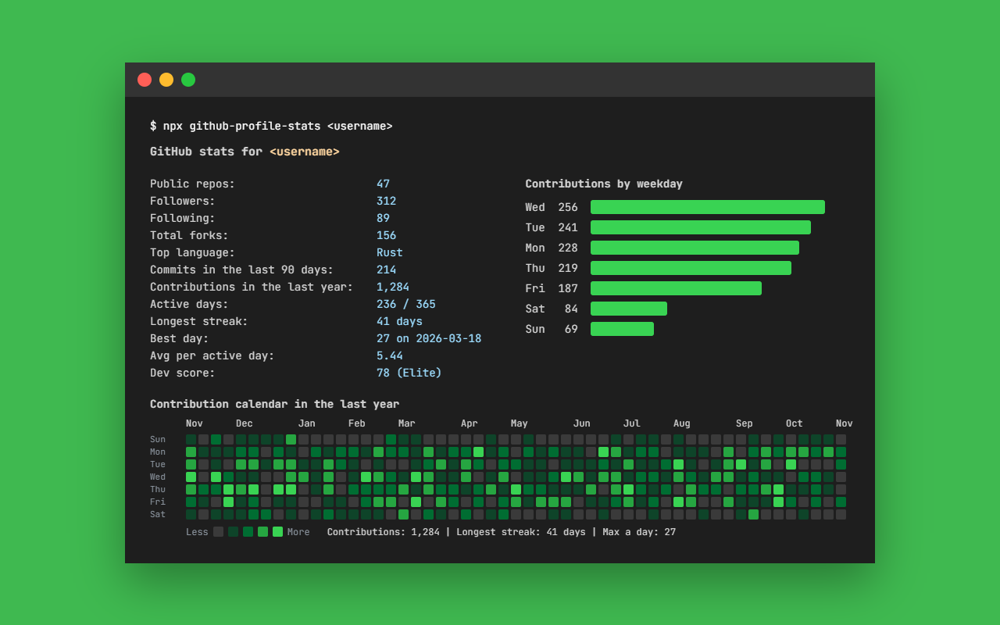

# github-profile-stats

GitHub profile and repository stats in your terminal



## Usage

```bash
npx github-profile-stats <username>
```

Replace `<username>` with any GitHub username. The command prints a short report with the user's public repos, followers, following, stars, forks, top language, recent commits, contribution streaks and a dev score. Use `-r <owner/name>` to get a report for a repository instead.

## Options

```
-u, --user <user>         The GitHub user to get stats about.
-r, --repo <owner/name>   The full repository name to get stats about.
-c, --calendar            Show the contribution calendar.
-w, --weekday             Show contributions by weekday.
-m, --monthly             Show contributions by month.
-l, --languages           Show the language breakdown.
    --top <number>        Show the most starred repositories (default: 5 with --all).
-a, --all                 Show every section.
-y, --year <year>         Use contributions from a specific year instead of the last 12 months.
    --theme <name>        Color of the calendar and charts. Use it with -c, -w, -m, -l or -a.
                          Themes: green (default), blue, purple, orange, mono.
    --compare <user>      Compare the user with another GitHub user.
-d, --days <number>       Number of days to count commits for (default: 90).
-t, --token <token>       GitHub access token to increase the rate limit.
-j, --json                Print the report as JSON.
-n, --no-ansi             Disable ANSI styles.
-h, --help                Display this help.
```

Examples:

```bash
npx github-profile-stats <username> --calendar --weekday
npx github-profile-stats <username> --calendar --theme orange
npx github-profile-stats <username> --all --theme blue
npx github-profile-stats <username> -c -y 2025
npx github-profile-stats <username> --top 10
npx github-profile-stats <username> --compare <other-username>
npx github-profile-stats -r <owner>/<repo>
npx github-profile-stats <username> --json
```

## What it shows

User report:

- Public repos, followers, following
- Total stars and forks across the user's own repositories
- Top language: the most common primary language across non-fork repositories
- Commits in the last N days: commits authored in public repositories
- Starred repos: number of repositories the user has starred
- Contributions, active days, longest streak, current streak and best day
- Dev score: a 1 to 99 score with a tier (Rookie, Rising, Pro, Elite, Legend) based on activity, stars, forks, followers, repos and streak

Sections:

- `--calendar`: a contribution calendar with a weekday row for each day and a column for each week
- `--weekday`: contributions per weekday as a bar chart
- `--monthly`: contributions per month as a bar chart
- `--languages`: share of repositories per language
- `--top <n>`: the most starred repositories
- `--compare <user>`: two users side by side, with the higher value highlighted

Contributions:

Contribution data comes from [github-contributions-api](https://github.com/grubersjoe/github-contributions-api). If that service is unavailable, the report is printed without the contribution rows and sections.

## Rate limits

Without a token the GitHub API allows 60 requests per hour. With a token the limit is 5000 requests per hour.

Create a token at GitHub

Pass the token with `--token`:

```bash
npx github-profile-stats <username> --token your_token
```

Or set the `GITHUB_TOKEN` environment variable.

macOS and Linux:

```bash
GITHUB_TOKEN=your_token npx github-profile-stats <username>
```

Windows PowerShell:

```powershell
$env:GITHUB_TOKEN = "your_token"
npx github-profile-stats <username>
```

## Requirements

Node.js 18.3 or newer.

## License

MIT
